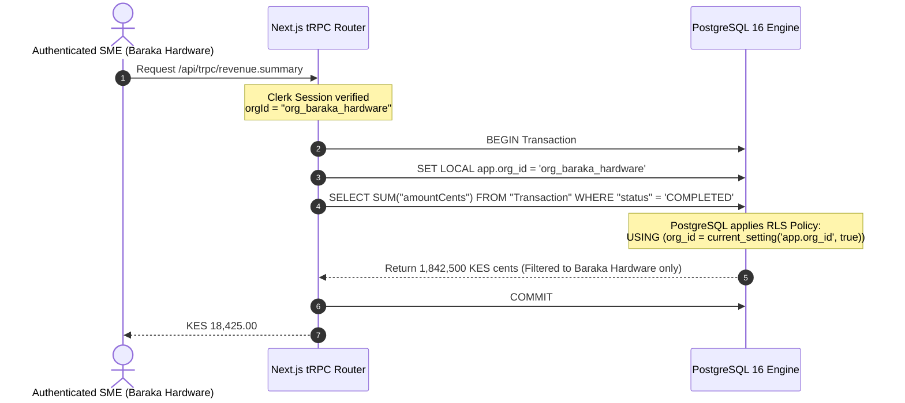
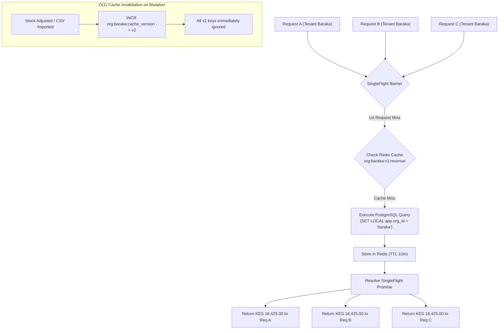

# Compass Analytics - System Architecture

Compass Analytics is a multi-tenant business analytics platform built for Kenyan SMEs to monitor real-time M-Pesa revenue, inventory velocity, and customer cohort retention.

---

## 1. High-Level System Architecture

```mermaid
flowchart TB
    subgraph Clients["Clients & Edge Gateway"]
        Browser["SME Dashboard Browser<br/>(Next.js 14 / Recharts)"]
        Safaricom["Safaricom Daraja API<br/>(C2B Validation & Confirmation)"]
        ALB["AWS Application Load Balancer<br/>(SSL Termination & Path Routing)"]
    end

    subgraph EKS["EKS Cluster (compass namespace)"]
        subgraph WebPods["compass-web Deployment (Next.js)"]
            NextServer["Next.js App Router<br/>(Node 20 / tRPC v10)"]
            SSEEndpoint["SSE Stream Route<br/>(/api/stream/revenue)"]
            CacheLayer["SingleFlight Cache Layer<br/>(SuperJSON)"]
        end

        subgraph IngestPods["compass-ingest Deployment (Go)"]
            GoChi["Chi HTTP Engine<br/>(:8080/mpesa/c2b/*)"]
            Workers["Goroutine Worker Pool<br/>(8 Consumers/Pod)"]
            MetricsExporter["Prometheus Exporter<br/>(:9100/metrics)"]
        end
    end

    subgraph DataTier["Isolated Database Subnets"]
        Redis[("ElastiCache Redis 7<br/>- Streams (mpesa:txns)<br/>- PubSub (org:{id}:txn)<br/>- SingleFlight Cache")]
        Postgres[("RDS PostgreSQL 16<br/>- Engine RLS: app.org_id<br/>- BigInt KES Cents<br/>- Hourly Rollups")]
    end

    subgraph ObservabilityTier["Monitoring Stack"]
        Prometheus["Prometheus Server<br/>(Scraping :9100)"]
        Grafana["Grafana Dashboards<br/>(Throughput / SLA / Lag)"]
    end

    %% Ingress routing
    Safaricom -->|POST /mpesa/c2b/*| ALB
    Browser -->|HTTPS /*| ALB
    ALB -->|Route /mpesa/*| GoChi
    ALB -->|Route /*| NextServer

    %% Ingestion pipeline
    GoChi -->|XADD mpesa:txns (sub-3ms)| Redis
    Redis -->|XREADGROUP| Workers
    Workers -->|SET LOCAL app.org_id<br/>Upsert Txn & Customer| Postgres
    Workers -->|PUBLISH org:{id}:txn| Redis

    %% Real-time SSE & Caching
    Redis -->|SUBSCRIBE| SSEEndpoint
    SSEEndpoint -.->|Text/Event-Stream| Browser
    NextServer --> CacheLayer
    CacheLayer -->|Get / Set (v{N})| Redis
    CacheLayer -->|SET LOCAL app.org_id<br/>Query Analytics| Postgres

    %% Metrics
    MetricsExporter -.->|Scrape| Prometheus
    Prometheus --> Grafana
```

---

## 2. Multi-Tenant Row-Level Security (RLS) Isolation Boundary

Multi-tenancy in Compass Analytics is enforced at the PostgreSQL engine level, not in application-level `WHERE` clauses.



If any code executes a query without `SET LOCAL app.org_id`, PostgreSQL evaluates `current_setting('app.org_id', true)` to `NULL` and yields **zero rows**. This prevents cross-tenant leakage even under query bugs or injection attempts.

---

## 3. High-Throughput M-Pesa Ingestion Pipeline

Safaricom requires Daraja C2B webhooks to return `ResultCode: 0` in under 250 milliseconds. Processing writes directly in the webhook handler risks timeouts during database locks or maintenance.

```mermaid
sequenceDiagram
    autonumber
    participant Safaricom as Safaricom Gateway
    participant Ingest as Go Ingest HTTP (:8080)
    participant Redis as Redis Streams (mpesa:txns)
    participant Worker as Goroutine Worker
    participant DB as PostgreSQL 16 (RLS)
    participant SSE as Next.js SSE Stream

    Safaricom->>Ingest: POST /mpesa/c2b/confirmation/org_baraka_hardware
    Note over Ingest: Validate JSON & Mask MSISDN<br/>Compute HMAC-SHA256 Hash
    Ingest->>Redis: XADD mpesa:txns * (TransID, OrgID, AmountCents, ...)
    Ingest-->>Safaricom: 200 OK {"ResultCode": 0, "ResultDesc": "Success"} (Latency < 3ms)
    
    par Async Processing
        Redis->>Worker: XREADGROUP mpesa_workers
        Note over Worker: Check dedup key in Redis<br/>dedup:mpesa:{org_id}:{trans_id}
        Worker->>DB: BEGIN; SET LOCAL app.org_id = 'org_baraka_hardware';
        Worker->>DB: UPSERT Transaction & Customer
        Worker->>DB: UPSERT HourlyRevenueRollup
        Worker->>DB: COMMIT;
        Worker->>Redis: XACK mpesa:txns mpesa_workers {msg_id}
        Worker->>Redis: PUBLISH org:org_baraka_hardware:txn {payload}
        Redis->>SSE: Event received via Pub/Sub
        SSE-->>Safaricom: (Live UI update pushed to dashboard)
    end
```

---

## 4. SingleFlight Stampede Protection & O(1) Cache Invalidation

To protect PostgreSQL connection limits when thousands of SME dashboards refresh simultaneously:



---

## 5. Security & Cryptographic Boundaries

1. **At-Rest Encryption**:
   - Customer-managed AWS KMS key (`alias/compass-production`) encrypts PostgreSQL EBS volumes, ElastiCache Redis memory dumps, and AWS Secrets Manager.
   - Daraja Consumer Secrets and Passkeys are encrypted in PostgreSQL using **AES-256-GCM** with authenticated 96-bit nonces.
2. **Customer Privacy**:
   - Safaricom MSISDNs (phone numbers) are never stored in plaintext. They are:
     - Masked for display: `254712***789`
     - Hashed with tenant-salted HMAC-SHA256 for cohort identification across visits without storing PII.
3. **Transport Security**:
   - In-transit TLS 1.3 enforced on AWS ALB, internal pod-to-pod communication, and Redis/PostgreSQL connections (`sslmode=require`).
   - Zero-trust Kubernetes NetworkPolicies deny inter-pod traffic outside defined service contracts.
