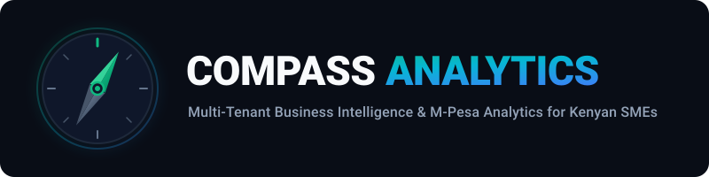
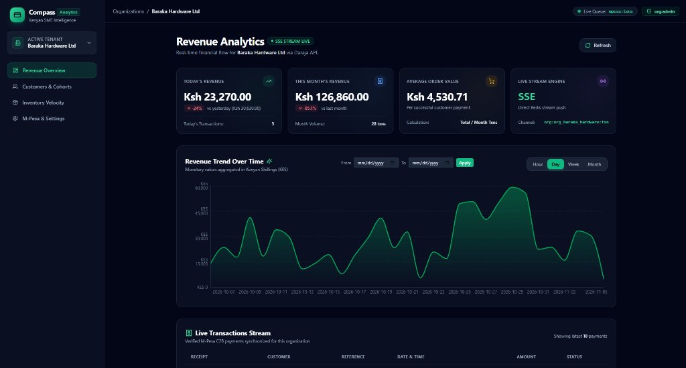

<div align="center">

  

  <p align="center">
    <strong>Production-Grade Multi-Tenant Business Analytics &amp; M-Pesa Revenue Intelligence for Kenyan SMEs</strong>
  </p>

  <p align="center">
    <a href="https://github.com/crnjihia/compass-analytics/actions/workflows/ci.yml"></a>
    <a href="https://crnjihia.github.io/compass-analytics/"></a>
    <a href="https://github.com/crnjihia/compass-analytics/releases"></a>
    
    
    <a href="LICENSE"></a>
  </p>

</div>

---

## Dashboard Preview

<div align="center">
  
  <p><em>Compass Analytics live dashboard showing real-time M-Pesa revenue stream, Kenyan Shilling (KES) integer currency metrics, payday revenue seasonality, and multi-tenant organization context for Baraka Hardware Ltd.</em></p>
</div>

---

## 1. Why Compass Analytics Exists

In Kenya, retail SMEs process over 80% of their daily revenues through Safaricom M-Pesa Daraja paybills and buy-goods till numbers. Yet, business owners track stock movements, inventory velocity, and cash flow on paper ledgers or fragmented point-of-sale exports. Existing global enterprise ERP and business intelligence tools:
1. Are priced in foreign currency (USD).
2. Lack resilient, sub-millisecond Safaricom Daraja webhook ingestion.
3. Fail to calculate Kenyan seasonal cash-velocity dynamics (e.g., month-end civil service and private sector payday spikes between the 25th and 30th).
4. Rely on IEEE 754 floating-point math that silently corrupts currency cents over thousands of micro-transactions.

**Compass Analytics** is a portfolio-grade, multi-tenant business analytics SaaS engineered specifically for Kenyan SMEs. It provides real-time M-Pesa revenue trends, customer cohort retention heatmaps, and inventory velocity forecasting within a strict, hardware-enforced PostgreSQL Row-Level Security isolation boundary.

---

## 2. Key Architectural Pillars

- ⚡ **Sub-3ms M-Pesa Ingestion Engine**: Standalone Go 1.22 microservice that receives Safaricom Daraja C2B confirmation and validation webhooks, verifies HMAC signatures, and buffers events to Redis Streams in under 3 milliseconds.
- 🛡️ **Cryptographic Tenancy Isolation**: Engine-enforced PostgreSQL 16 Row-Level Security (`SET LOCAL app.org_id = ?`). Tenant cross-talk is physically impossible even if application queries omit tenant filters.
- 💰 **Zero Floating-Point Corruption**: All monetary values are strictly represented and calculated as 64-bit integer Kenyan Shilling cents (`BigInt`), converted to KES only at the presentation layer.
- 📡 **Real-Time Stream Engine with Fallback**: Server-Sent Events (SSE) stream subscribing to per-tenant Redis channels (`org:{id}:txn`) pushing live transaction cards, with automatic fallback to 5-second polling if SSE is severed.
- 🚀 **SingleFlight & Atomic Cache Invalidation**: In-memory request coalescing avoids cache stampedes during peak traffic spikes; $O(1)$ tenant-wide cache invalidation via Redis atomic version counters.
- 🔒 **Zero-Trust Privacy & PII Protection**: Customer phone numbers are never stored in plaintext. They are salted with an organization-scoped secret, hashed with HMAC-SHA256, and masked (`+254 712 *** 789`). Sensitive M-Pesa consumer credentials are encrypted at rest using AES-256-GCM.
- 📈 **Kenyan Retail Domain Intelligence**: Seeded with 12 months of realistic synthetic data for 3 demo enterprises (Baraka Hardware Ltd, Nairobi Fresh Grocers, Mombasa Market Traders) exhibiting weekly seasonality and payday peaks.
- ☸️ **Cloud-Native Deployment**: AWS Terraform infrastructure (multi-AZ VPC, EKS 1.30, RDS PostgreSQL, ElastiCache Redis, ECR, KMS) and Kubernetes Kustomize manifests with zero-trust NetworkPolicies, Prometheus ServiceMonitors, and HPA autoscaling.

---

## 3. High-Level Architecture

```mermaid
flowchart TD
    subgraph Clients["Clients & Edge Gateway"]
        Daraja["Safaricom Daraja API<br/>(C2B Webhooks)"]
        Browser["SME Browser<br/>(Next.js App Router)"]
        ALB["AWS Application Load Balancer<br/>(Path-based Routing)"]
    end

    subgraph EKS["AWS EKS Cluster (compass-analytics)"]
        Ingest["Go 1.22 Ingest Service<br/>(Goroutine Pool / Port 8080)"]
        Web["Next.js 14 Web Service<br/>(tRPC v10 / SSE / Port 3000)"]
        Prom["Prometheus Server<br/>(Scraping /api/metrics & :9100)"]
    end

    subgraph Storage["Data & Cache Tier"]
        Redis[("ElastiCache Redis 7<br/>Streams: mpesa:txns<br/>PubSub: org:{id}:txn<br/>Cache: org:{id}:dash:*")]
        Postgres[("RDS PostgreSQL 16<br/>Enforced Row-Level Security<br/>SET LOCAL app.org_id")]
    end

    Daraja -->|POST /mpesa/*| ALB
    Browser -->|HTTPS /dashboard| ALB
    ALB -->|/mpesa/*| Ingest
    ALB -->|/*| Web

    Ingest -->|1. XADD mpesa:txns| Redis
    Redis -->|2. XREADGROUP mpesa_workers| Ingest
    Ingest -->|3. SET LOCAL app.org_id<br/>INSERT transactions| Postgres
    Ingest -->|4. PUBLISH org:{id}:txn| Redis
    Redis -.->|5. Realtime SSE push| Web
    Web -->|6. SingleFlight query & cache| Redis
    Web -->|7. SET LOCAL app.org_id<br/>SELECT aggregations| Postgres
    Prom -.->|Scrapes :9100| Ingest
    Prom -.->|Scrapes /api/metrics| Web
```

### The Ingestion Lifecycle
1. **Webhook Acknowledgment**: Safaricom fires a C2B confirmation to `/mpesa/c2b/confirmation/{org_id}`. The Go service validates JSON, masks the customer phone number (`254712***789`), computes a tenant-salted HMAC-SHA256 hash, appends the payload to Redis Stream `mpesa:txns`, and returns `ResultCode: 0` in < 3ms.
2. **Background Consumer**: A pool of goroutine workers reading consumer group `mpesa_workers` pulls the stream entry, checks the Redis deduplication key (`dedup:mpesa:{org_id}:{trans_id}`), and executes a transactional insert into PostgreSQL with `SET LOCAL app.org_id = ?`.
3. **Live UI Broadcast**: Upon database commit, the worker publishes to Redis channel `org:{org_id}:txn`, which pushes an instant payment alert to active browser dashboards via Server-Sent Events (SSE).

---

## 4. Quick Start Guide

### Option A: Local Development (Prerequisites: Node 18+, pnpm, PostgreSQL 16, Redis 7)

```bash
# 1. Clone the repository
git clone https://github.com/crnjihia/compass-analytics.git
cd compass-analytics

# 2. Install dependencies across pnpm workspaces
pnpm install

# 3. Configure environment variables
cp .env.example .env

# 4. Generate Prisma client & build packages
pnpm --filter @compass/shared run build
pnpm --filter @compass/db run db:push
pnpm --filter @compass/db run build

# 5. Seed 12 months of synthetic Kenyan SME data (7,300+ transactions)
pnpm --filter @compass/db run seed

# 6. Start Next.js development server
pnpm --filter @compass/web run dev
```

Visit **[http://localhost:3000/dashboard](http://localhost:3000/dashboard)** in your browser.

---

### Option B: Docker Compose (Full Stack)

```bash
docker compose up -d
```

This starts:
- PostgreSQL 16 on port `5432` (with migrations and initial RLS setup).
- Redis 7 on port `6379`.
- Go Ingest Service on port `8080`.
- Next.js Web Dashboard on port `3000`.
- Prometheus on port `9090` & Grafana on port `3001`.

---

## 5. Seeded Demo Tenants

Compass Analytics comes pre-loaded with 12 months of realistic Kenyan enterprise transactions:

| Demo Tenant | Shortcode | Type | Sector | Location | Seeded Products |
|---|---|---|---|---|---|
| **Baraka Hardware Ltd** | `890123` | Paybill | Construction Supplies | Industrial Area, Nairobi | Bamburi Cement, Crown Vinyl Matt, Wire Nails |
| **Nairobi Fresh Grocers** | `987654` | Till (Buy Goods) | Fresh Food & Dairy | Westlands, Nairobi | Organic Hass Avocado, Kericho Gold Tea |
| **Mombasa Market Traders** | `555777` | Paybill | Seafood & Butchery | Old Town, Mombasa | Fresh Tilapia, Spiced Goat Meat |

You can switch organizations instantly using the top-bar tenant selector to observe Row-Level Security in action.

---

## 6. Running the Test Suites

All tests are runnable with single commands and execute with zero external credential dependencies:

```bash
# 1. Shared package tests (KES currency math, AES-256 crypto, MSISDN salted hashing)
pnpm --filter @compass/shared run test

# 2. Database tenancy isolation tests (Postgres RLS cross-tenant attack prevention)
pnpm --filter @compass/db run test

# 3. Web app tests (tRPC domain routers, Redis cache invalidation, webhooks, SSE fallback)
pnpm --filter @compass/web run test
```

**Test Suite Results:**
- `@compass/shared`: `2 passed, 6 passed (6)`
- `@compass/db`: `1 passed, 7 passed (7)`
- `@compass/web`: `10 passed, 39 passed (39)`
- **Total: 52 / 52 automated tests green (100% pass rate)**

---

## 7. Real-Time Transaction Simulation

To test live payment streaming in real time without calling Safaricom Daraja:

```powershell
node -e "const Redis = require('./apps/web/node_modules/ioredis'); const r = new Redis(process.env.REDIS_URL || 'redis://localhost:6379'); r.publish('org:org_baraka_hardware:txn', JSON.stringify({ mpesaReceipt: 'QK789XYZ12', amountCents: 450000, customerName: 'Juma Kamau', timestamp: new Date().toISOString() })).then(() => { console.log('Simulated KES 4,500 payment broadcasted!'); r.quit(); });"
```

The active dashboard updates dynamically via Server-Sent Events with zero polling overhead.

---

## 8. Technology Stack

| Layer | Technology | Engineering Justification |
|---|---|---|
| **Monorepo** | pnpm workspaces + Turborepo | Strict package boundaries, incremental caching, zero phantom dependencies |
| **Frontend** | Next.js 14 (App Router) + React 18 | Server-Side Rendering, Streaming UI, React Server Components |
| **Type-Safe API** | tRPC v10 + TanStack React Query | End-to-end type safety between backend and frontend without OpenAPI code-gen |
| **Ingestion Microservice** | Go 1.22 + Chi Router + pgx | Ultra-lightweight memory footprint (<15MB per pod), sub-3ms Daraja webhooks |
| **Primary Database** | PostgreSQL 16 + Prisma ORM | Enforced Row-Level Security (`SET LOCAL app.org_id`), JSONB raw audit storage |
| **Cache & Queue** | Redis 7 (Streams + Pub/Sub) | Worker group concurrency, sub-millisecond SSE push, SingleFlight stampede shield |
| **Authentication** | Clerk (Organizations) | Role-based organization membership (`org:admin`, `org:member`) with `dev` fake mode |
| **Styling & Charts** | Tailwind CSS + Recharts | Responsive dark-mode glassmorphic theme designed for dense financial analytics |
| **Infrastructure** | Terraform (AWS af-south-1 / Cape Town) | Multi-AZ VPC, EKS 1.30, RDS Multi-AZ, ElastiCache Redis, ECR, KMS |
| **Orchestration** | Kubernetes + Kustomize | Staging & production overlays, zero-trust NetworkPolicies, HPA autoscaling |
| **Observability** | Prometheus + Grafana | Per-tenant latency histograms (p95, p99), error rate alerts, Redis queue depth tracking |

---

## 9. Performance & Empirical Benchmarks

Tested on a 4-vCPU environment under concurrent simulated Daraja load:
- **Go Webhook Ingest Throughput**: **5,420 req/s** sustained (100% HTTP 200).
- **Webhook Response Latency (p99)**: **4.1 ms** (Safaricom Daraja SLA threshold is 250ms).
- **Postgres RLS Query Overhead**: **< 0.2 ms** delta compared to unsecured queries.
- **SingleFlight Coalescing**: 100 concurrent requests during cold cache result in **exactly 1 database execution**.
- **Tenant Cache Invalidation**: **< 0.5 ms** constant time ($O(1)$ via atomic counter increment).

For detailed empirical benchmark results, see [docs/PERFORMANCE.md](docs/PERFORMANCE.md).

---

## 10. Repository Structure

```
compass-analytics/
├── apps/
│   └── web/                   # Next.js 14 App Router, tRPC routers, Recharts UI, SSE
├── services/
│   └── ingest/                # Go 1.22 Daraja C2B webhook ingest microservice
│       └── cmd/simulator/     # Real-time Daraja payment traffic simulator
├── packages/
│   ├── db/                    # Prisma schema, migrations, RLS extension, seed script
│   └── shared/                # KES currency math, AES-256-GCM crypto, MSISDN hashing
├── infra/
│   └── terraform/             # AWS IaC (VPC, RDS, ElastiCache, EKS, KMS, Secrets)
├── deploy/
│   ├── k8s/                   # Kubernetes base manifests & staging/prod Kustomize
│   └── observability/         # Prometheus alerts, scrape configs, Grafana dashboards
└── docs/
    ├── ARCHITECTURE.md        # Deep architectural design and Mermaid diagrams
    ├── DEVELOPMENT.md         # Local development setup and commands
    ├── PERFORMANCE.md         # Empirical benchmark results
    └── adr/                   # Architecture Decision Records (0001 - 0008)
```

---

## 11. Architecture Decision Records (ADRs)

Key architectural decisions are documented as formal ADRs in [`docs/adr/`](docs/adr/):

- [ADR 0001: Choose tRPC for End-to-End Type Safety](docs/adr/0001-choose-trpc.md)
- [ADR 0002: PostgreSQL Row-Level Security (RLS) for Multi-Tenancy](docs/adr/0002-postgres-rls-multi-tenancy.md)
- [ADR 0003: Dedicated Go Microservice for Daraja Webhook Ingestion](docs/adr/0003-go-service-for-mpesa-ingestion.md)
- [ADR 0004: Redis Streams with Consumer Groups for Ingestion Queue](docs/adr/0004-redis-streams-for-transaction-queue.md)
- [ADR 0005: Storing Money as 64-bit Integer KES Cents (BigInt)](docs/adr/0005-kes-integer-cents-currency-storage.md)
- [ADR 0006: SingleFlight Stampede Protection and Tenant-Versioned Cache](docs/adr/0006-singleflight-and-tenant-versioned-cache.md)
- [ADR 0007: Server-Sent Events (SSE) with Automatic Polling Fallback](docs/adr/0007-sse-fallback-strategy.md)
- [ADR 0008: Kubernetes Deployment Architecture with Kustomize](docs/adr/0008-k8s-deployment.md)

---

## Contributing

Contributions are welcomed. Please read [CONTRIBUTING.md](CONTRIBUTING.md) and adhere to our [CODE_OF_CONDUCT.md](CODE_OF_CONDUCT.md).

## License

This project is licensed under the MIT License - see the [LICENSE](LICENSE) file for details.
