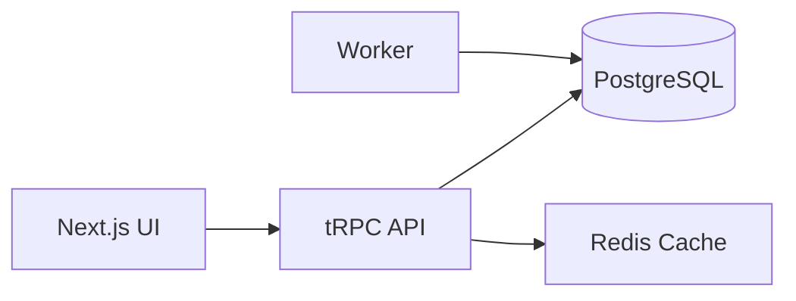

# Compass Analytics


[](https://github.com/yourusername/compass-analytics/actions/workflows/ci.yml)
[](LICENSE)

**One‑line tagline describing the product.**

## Why this exists

*Problem statement in 3 sentences, grounded in the Kenyan context.*

## Features

- 📈 Revenue trends dashboard
- 📊 Customer cohort analysis
- 📦 Inventory velocity insights
- 🚀 Live ticker with M‑Pesa payments (Shop Heartbeat)
- 🌐 Swahili/English language switch

## Architecture



## Quick Start

```bash
make setup    # install dependencies
make dev      # start the dev server
```

## Configuration

| Variable | Description | Default |
|---|---|---|
| `DATABASE_URL` | PostgreSQL connection string | `postgresql://localhost/compass` |
| `REDIS_URL` | Redis connection string | `redis://localhost:6379` |
| `NEXT_PUBLIC_LANGUAGE` | UI language (`en` or `sw`) | `en` |

## Demo Mode

*Instructions for seeded demo data and login details.*

## Tech Stack

| Component | Choice | Reason |
|---|---|---|
| Front‑end | Next.js 14 (App Router) | Server‑side rendering, SEO, React ecosystem |
| Types | TypeScript strict | Type safety across stack |
| API | tRPC | End‑to‑end type safety |
| Charts | Recharts | Simple, composable charts |
| Styling | Tailwind CSS | Utility‑first, custom design tokens |
| DB | PostgreSQL + Prisma | Powerful relational DB, row‑level security |
| Cache | Redis | Fast query caching |
| Auth | Clerk (fallback stub) | Easy multi‑tenant auth |

## What is Real vs Simulated

| Feature | Real / Simulated |
|---|---|
| M‑Pesa sandbox | Simulated via Daraja sandbox |
| Payments | Real‑time via mock events |
| Tenant isolation | Enforced with RLS (real) |
| Charts | Real data from DB |

## Testing & Benchmarking

*Details on test coverage, k6 load test results, performance numbers.*

## Project Structure

```
.
├─ app/                # Next.js app router pages
├─ docs/               # Documentation and ADRs
├─ src/                # Source code (API, workers)
├─ prisma/             # Prisma schema (if used)
├─ .husky/             # Git hooks
├─ .github/            # CI workflows
├─ Makefile            # Build commands
└─ ...
```

## Roadmap

- [ ] Implement transaction ingestion worker
- [ ] Add North Star insights card
- [ ] Internationalization (i18n) support
- [ ] Deploy to Kubernetes (Terraform) 

## Contributing

See [CONTRIBUTING.md](CONTRIBUTING.md) for guidelines.

## License

MIT © <YOUR NAME>
